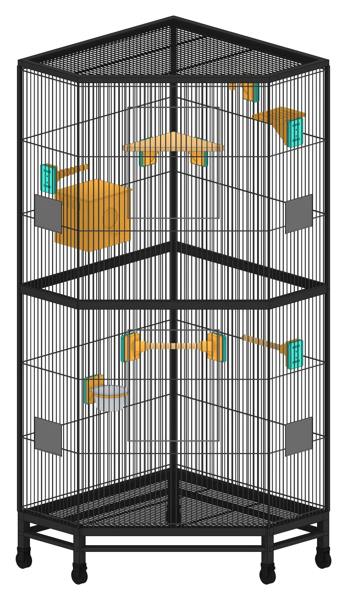
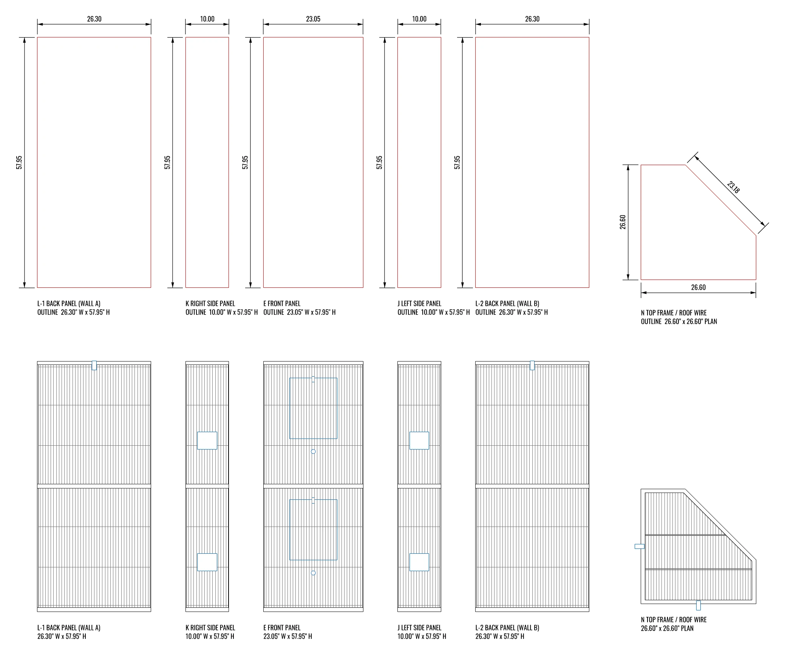
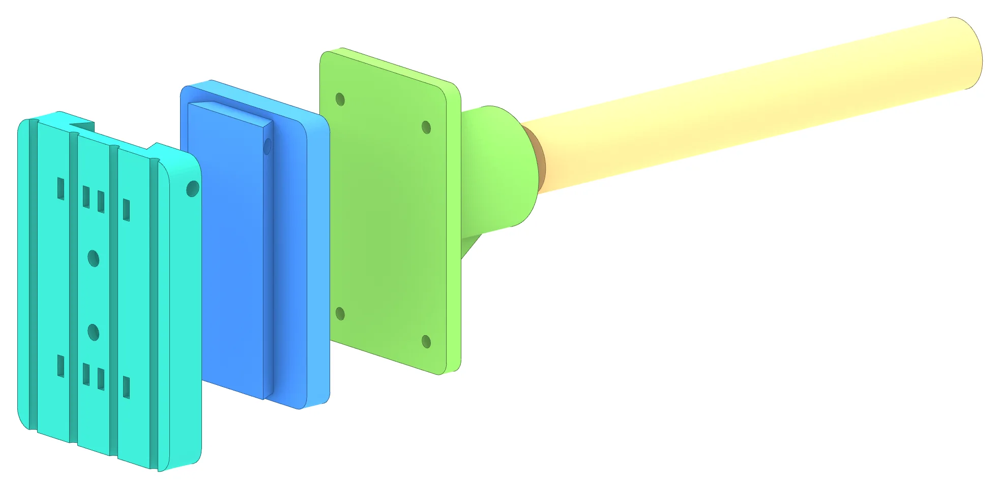
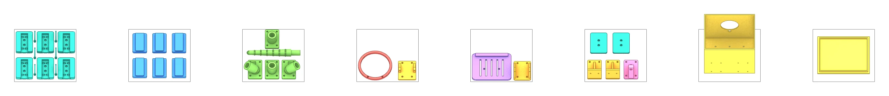

# hark_dove_habitat

**Dove Habitat**: standardized, 3D-printable mounts and accessories for a wire
bird cage. Every accessory attaches through the same interface, so **any
accessory fits on any mount** and can be moved or swapped without tools beyond
a hex key. Its design documentation is a site of its own,
**https://dove.felipeharker.org/**, opened from its tile on the
portfolio, [felipeharker.org](https://felipeharker.org/).



The site is built to the Hark web standards, which live in
[`hark_web`](https://github.com/felipeharker/hark_web) and are served at
https://felipeharker.org/standards/. The page links
`https://felipeharker.org/standards/hark.css`, then its own
`assets/site.css`; there is no copy of the standard here. Then it links the
standard's one script, `https://felipeharker.org/standards/hark.js`, which
sets the page in the design — sans or serif — the reader chose on
felipeharker.org's front page. It is a project
site, not one of the family of sites in every other page's site links: its
running head and its site links lead home, to the portfolio, and nowhere
else.

## Base Cage

Designed around the All Living Things **64" Tall Corner Home** (model 5351668).
The manufacturer's assembly instructions are kept on disk, out of the
repository (see [Working Files](#working-files)).

| Spec | Value |
| --- | --- |
| Overall size | 26.3" L × 26.3" W × 64.1" H |
| Wire spacing | **5/8"** — the grid every mount is designed to |
| Back panels L-1 / L-2 (walls A / B) | 26.30" W × 57.95" H |
| Side panels J (left) / K (right) | 10.00" W × 57.95" H |
| Front panel E | 23.05" W × 57.95" H |
| Top frame N (roof wire) | 26.60" × 26.60" plan, 23.18" diagonal |



## The Standard Interface

Each accessory is a stack of the same layers, from the cage wire outward:

1. **MP-1 wire mount** — clamps onto the 5/8" wire grid. Kit: MP-1 + BP-1
   backer + LK-1 pin, fixed with 4 zip ties or 2 × M4.
2. **KA-1 key adapter** — dovetail key that slides into the mount.
3. **Swappable head** — fastens to KA-1 with 4 × M3 screws into heat-set inserts.
4. **Function parts** — the dowel, cup, deck, board, etc. that the head carries.



## Accessory Catalog

| ID | Accessory | Printed parts | Buy / cut |
| --- | --- | --- | --- |
| MP-1 | Wire mount kit | MP-1, BP-1, LK-1 | 4 zip ties or 2 × M4 |
| PH-1 | Dowel perch (straight) | KA-1, PH-1 head | 3/4" dowel |
| PH-2 | Corner perch (45° L/R) | KA-1, PH-2 L/R head | 3/4" dowel |
| PP-1 | Grip perch (26→16 mm taper) | KA-1, PH-1 head, PP-1 perch | — |
| BH-1 | Bowl holder | KA-1, bracket, ring | 4" stainless cup |
| LP-1 | Landing pad (140 × 110 mm deck) | KA-1, bracket, deck | — |
| SB-1 | Shelf bracket (corner shelf) | KA-1, SB-1 head | 1/2" wood board |
| NB-1 | Hideout box (2 mounts, 65 mm entry) | 2 × KA-1, body, lid | 12 mm dowel |
| TH-1 | Toy hanger | KA-1, TH-1 head | stainless quick link |

Colour in the renders indicates function: mount, key adapter, structure, perch,
feeding, platform, shelter, toy, wood (buy/cut), hardware (buy).

## Printing

PETG, 4 walls, 40% gyroid, 220 × 220 mm bed. Parts are laid out in print
orientation and need no supports.

| Plate | Contents |
| --- | --- |
| P1 · Mount | MP-1 × 6, LK-1 × 6 |
| P2 · Key adapter | KA-1 × 6 |
| P3 · Perch | PH-1 × 2, PH-2 L + R, PP-1 |
| P4 · Feeding | BH-1 ring + bracket |
| P5 · Platform | LP-1 deck + bracket |
| P6 · Structure / toy | SB-1 × 2, TH-1, BP-1 × 2 |
| P7 · Shelter | NB-1 body (open top up) |
| P8 · Shelter | NB-1 lid (top down) |

Run P1 and P2 twice for the sample cage layout (12 mounts).



## Layout

```
hark_dove_habitat/
  README.md
  AGENTS.md                   rules for coding agents (CLAUDE.md points here)
  render.yaml                 the Render service, recorded
  tools/
    site.mjs                  this site's address, and where its links lead
    serve.mjs                 serve site/ locally
    check.mjs                 check the page, its links and the published files
  site/                       published, and nothing else
    index.html                the design documentation, as one page
    assets/site.css           what the page adds to the standard: figure grids, drawings, elevations
    img/                      renders exported from the Rhino model, as WebP
  source/                     working files, on disk only: git ignores it
```

## Editing

| Want to change | Edit |
|---|---|
| Any text or table | `site/index.html` |
| An accessory | both places it appears in `site/index.html`: its render in the grid, and its `<details>` row |
| A drawing (callouts, dimensions, sections, the plan, the elevations) | the inline `<svg>` in `site/index.html`, regenerated from the model rather than edited by hand |
| The figure grids, the drawings, the elevations | `site/assets/site.css`, commented |
| Anything shared: type, the grid, tables, plates, the footer | the standard, in `hark_web` |

Images are named in lowercase kebab-case (`cat-bh1.webp`), because anything
served is a URL. Every `` has `alt`, and `loading="lazy"` below the
first screen.

## Running and Checking

Node 20.9 or newer, nothing else.

```bash
node tools/serve.mjs
node tools/check.mjs
```

The first serves the page at http://localhost:8000/; the second runs before
every commit.

## Working Files

`source/` holds what the site is made from, on disk and out of git: the
Rhino model (`dove_habitat_v1.0.3dm`), the print-ready STLs (`stl/`, one
folder per accessory, one file per part, in millimetres), the design
documentation PDF, the manufacturer's assembly instructions for the base
cage, and the original PNG renders. Models, meshes and PDFs stay out of the
repository, and no page links a PDF (`hark_web`, `planning/decisions.md`).

This repository was made on 2026-10-20 from the private `dove_habitat`, as
it stood at `e4db1c7`, with a fresh history. That repository is archived as
`dove_habitat_archive`.

## Deploying

A Render static site, `hark-dove-habitat`, deployed from `main` on every
push: no build step, publish directory `site`. The settings are recorded in
[`render.yaml`](render.yaml).

Its address is dove.felipeharker.org, the service's custom domain: a
Porkbun CNAME to hark-dove-habitat.onrender.com, which still answers but is
linked from nowhere.
